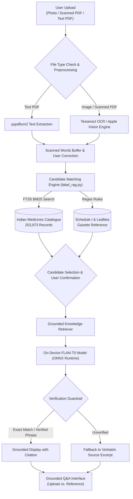

# 🏥 MedLabel India

[](https://share.streamlit.io/deploy?repository=Sai0045/medlabel-india&branch=main&mainModule=app.py)


-005CED.svg)


> **MedLabel India** is an intelligent, offline-capable Indian medicine strip and leaflet reader. Upload a photo, scanned image, or text PDF of a medicine package to extract printed text via OCR, match it against an exhaustive catalogue of **253,973+ Indian pharmaceutical products**, and explore grounded, evidence-backed patient guidance powered by an on-device quantized **FLAN-T5** language model with strict anti-hallucination guardrails.

---

## 🌟 Key Features

- 📷 **Multi-Format Ingestion**: Supports high-resolution images (`.png`, `.jpg`, `.jpeg`), native text PDFs, and rasterized/scanned PDFs up to 10 MB.
- 🔍 **Hybrid Text Extraction**:
  - Direct PDF text layer extraction using `pypdfium2`.
  - Fallback rasterization and OCR with **Tesseract OCR** (Linux / Windows) and **Apple Vision OCR** (macOS).
  - Sandboxed execution with strict resource bounds, input sanitization, and image size safeguards.
- 📚 **Exhaustive Indian Medicine Catalogue (253,973+ Records)**:
  - Compressed SQLite index with **FTS5 BM25 search**.
  - Intelligent candidate matching filtering by brand name, formulation (tablets, capsules, syrups, injections), strength, units (`mg`, `mcg`, `ml`, `gm`), and salt composition.
  - Verified cross-referencing with the **Gazette of India (National List of Essential Medicines - Schedule I)** and official manufacturer leaflets (Alkem, GSK India, Sanofi, Crocin).
- 🧠 **On-Device Grounded Language Model (Zero API Cost)**:
  - Quantized **FLAN-T5-small** ONNX model running entirely on local CPU.
  - **Zero-Hallucination Guarantee**: Strict verification ensuring any generated explanation matches an exact sentence or verified phrase in the cited reference source.
  - Automatic fallback to verbatim excerpts if generation cannot be verified.
- 💬 **Grounded Q&A & Patient Guidance**:
  - Ask natural language questions about either the **Uploaded File** (quoted with page and line numbers) or the **Confirmed Medicine Reference**.
  - Preset patient FAQ options: common uses, side effects, active ingredients, warnings, and storage.
  - Built-in medical safety filters: explicitly declines personalized dosing advice and identifies medical emergency queries.
- 🔒 **Privacy-First Architecture**:
  - All processing occurs locally or on the dedicated host session.
  - Uploaded files, private OCR text, and user questions are **never** cached across sessions or transmitted to third-party cloud LLM APIs.

---

## 🚀 Live Demo & Deployment

### Run on Streamlit Community Cloud

You can deploy and run your own instance directly on Streamlit Community Cloud with a single click:

[](https://share.streamlit.io/deploy?repository=Sai0045/medlabel-india&branch=main&mainModule=app.py)

1. Sign in to [Streamlit Community Cloud](https://share.streamlit.io/) with your GitHub account.
2. Select repository: `Sai0045/medlabel-india`
3. Branch: `main`
4. Main file path: `app.py`
5. Click **Deploy!**

---

## 🛠️ Architecture & Workflow



---

## 💻 Local Quick Start

### 1. Prerequisites
- **Python 3.12**
- **Tesseract OCR**:
  - **Linux (Ubuntu/Debian)**: `sudo apt-get install -y tesseract-ocr tesseract-ocr-eng`
  - **Windows**: Install [UB-Mannheim Tesseract OCR](https://github.com/UB-Mannheim/tesseract/wiki) or via Winget: `winget install UB-Mannheim.TesseractOCR`
  - **macOS**: `brew install tesseract` or build the Apple Vision helper: `swiftc tools/vision_ocr.swift -o tools/vision_ocr`

### 2. Clone the Repository
```bash
git clone https://github.com/Sai0045/medlabel-india.git
cd medlabel-india
```

### 3. Create a Virtual Environment & Install Dependencies
```bash
# On Linux / macOS:
python3.12 -m venv .venv
source .venv/bin/activate
pip install -r requirements.txt

# On Windows (PowerShell):
py -3.12 -m venv .venv
.venv\Scripts\Activate.ps1
pip install -r requirements.txt
```

### 4. Run the Streamlit Application
```bash
streamlit run app.py
```
Open your browser at `http://localhost:8501`.

---

## 🧪 Testing & Evaluation Suite

Run the comprehensive unit test suite to verify file scanning, candidate matching, ONNX model generation, and Q&A citations:

```bash
# Run unit tests
python -m unittest discover -s tests -v

# Run grounded Q&A evaluation
python tools/evaluate_questions.py

# Run catalogue retrieval experiment
python tools/evaluate_catalogue.py
```

### Evaluation Results Summary

| Benchmark | Test Scope | Result | Observation |
|---|---|---|---|
| **Catalogue Retrieval** | 73 full product headings across 253,973 rows | **100% Top-1** (73/73) | Exact formulation identified |
| **Partial Headings** | 73 headings with final word removed | **82.2% Top-1** (58/73) | Correct candidate in Top-5 |
| **Negative Controls** | Mismatched strengths (e.g. 650 mcg vs 650 mg) | **100% Excluded** (6/6) | Prevented dangerous false matches |
| **Grounded Q&A** | 5 multi-scenario questions | **100% Pass** (5/5) | Full citation & safety refusals |

---

## 📂 Project Structure

```text
medlabel-india/
├── .streamlit/
│   ├── config.toml           # Streamlit theme, upload limits & headless settings
│   └── credentials.toml      # Headless credentials suppression
├── app.py                    # Application entry point
├── label_screen.py           # Main Streamlit UI, session management & layout
├── label_rag.py              # SQLite FTS5 candidate matching & passage retrieval
├── label_generator.py        # Local ONNX FLAN-T5 generator & verification logic
├── label_patient.py          # Grounded patient indications, FAQs & clinical sources
├── label_questions.py        # Interactive Q&A system with refusal & safety filters
├── reference.py              # Gazette of India Schedule I & brand dictionary
├── scan.py                   # Secure multi-format OCR & PDF ingestion worker
├── requirements.txt          # Pinned Python package dependencies
├── packages.txt              # OS-level packages for Linux / Streamlit Cloud
├── catalogue/
│   ├── manifest.json         # Checksums & chunk index
│   ├── part-00.gz .. part-03 # Compressed 253k product catalogue database
│   ├── patient.sqlite        # Grounded patient indication reference
│   └── patient_manifest.json # Integrity metadata
├── reader_model/
│   ├── encoder_model_quantized.onnx  # Quantized FLAN-T5 encoder
│   ├── decoder_model_quantized.onnx  # Quantized FLAN-T5 decoder
│   ├── tokenizer.json                # Hugging Face tokenizer
│   └── manifest.json                 # Model weights integrity hashes
├── data/
│   ├── indian_brands.json    # Manufacturer leaflet formulations
│   └── indian_schedule.json  # 459 Gazette of India Schedule I entries
├── examples/                 # Sample PDFs and PNGs for testing
├── tests/                    # Automated unit tests
└── tools/                    # Benchmarking & evaluation scripts
```

---

## ⚠️ Medical Disclaimer

**MedLabel India is designed solely for educational, research, and informational purposes.** It does not provide medical diagnoses, treatment advice, or personalized dosing. OCR may occasionally misread packaging text due to lighting, glare, or folds. Always verify printed label details with a qualified medical practitioner or licensed pharmacist.

---

## 📄 License & Attribution

- **Code**: Licensed under the [Apache License 2.0](LICENSE).
- **Model**: [FLAN-T5-small](https://huggingface.co/google/flan-t5-small) by Google Research (Apache 2.0). ONNX conversion via [Xenova](https://huggingface.co/Xenova/flan-t5-small).
- **Reference Data**: Gazette of India (National Pharmaceutical Pricing Authority) and publicly filed manufacturer package leaflets.
